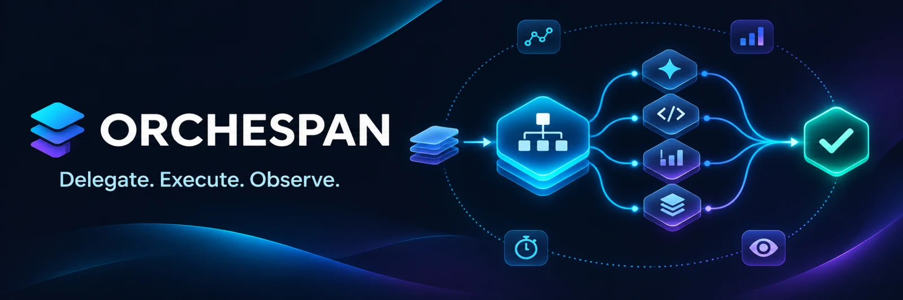
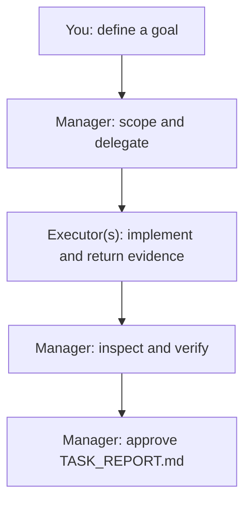

# Orchespan

**Delegate. Execute. Observe.**

**Markdown-first** · **Use your existing AI tools** · **No installation** · **MIT**

Orchespan is a **copy-and-use workflow for AI-assisted development**: one accountable manager, focused executor handoffs, proportionate verification, and a required completion report. It works with tools and subscriptions you already have.

> [!NOTE]
> This starter contains instructions, not an automatic agent runner. Parallel subagents depend on the capabilities and permissions of the tools you use.

## 🚀 Quick start

1. Copy `AGENTS.md`, the [role files](#included-files), and `work/TASK_REPORT.md` into your project. **If files already exist, merge the instructions; don't overwrite your project's rules. If you already have `CLAUDE.md`, keep `@AGENTS.md` as its first line.** Keep `.git/` and credentials out of the copy.
2. Open your AI assistant. For a Claude Code manager, use [`CLAUDE.md`](CLAUDE.md). For an independently operated `agy` executor, explicitly ask it to read [`GEMINI.md`](GEMINI.md) and `AGENTS.md`.
3. Give the manager a goal:

```text
Read AGENTS.md and your role instructions.
Goal: [describe the desired outcome].
Use one executor by default; delegate more only when useful.
Ask for evidence, review the result, then YOU (the manager)
must own and approve work/TASK_REPORT.md based on the
executor's findings and your verification. You may use a
bounded helper as a scribe. Executors must not edit it.
```

For larger work, optionally use [`SOL.md`](SOL.md) for strategic planning and `work/SOL_CONTRACT.md` for a durable task brief. **SOL** is simply the name of the optional planning role, not another required tool.

**Want to see the full multi-model setup?** Read the [operator-led workflow example](docs/operator-workflow.md). It is an optional example, not a required configuration.

## How it works



**Start with one executor.** Parallelize only independent work when supported, using separate branches or worktrees. When agents work in separate sessions, transfer a short handoff instead of assuming they share context. See the [first-task example](examples/first-task.md).

## Included files

| File | What it does |
| --- | --- |
| [`AGENTS.md`](AGENTS.md) | Shared rules, short handoff format and project context |
| [`CLAUDE.md`](CLAUDE.md) | Lean manager role |
| [`GEMINI.md`](GEMINI.md) | Direct `agy` executor role |
| [`SOL.md`](SOL.md) | Optional strategic planner |
| [`work/TASK_REPORT.md`](work/TASK_REPORT.md) | **Required for every task; manager-owned and evidence-based** |
| [`work/SOL_CONTRACT.md`](work/SOL_CONTRACT.md) | Optional contract for substantial tasks |
| [`work/TASK_STATE.md`](work/TASK_STATE.md) | Optional shared checkpoint |
| [`work/TASK_LEDGER.md`](work/TASK_LEDGER.md) | Optional multi-task status register |

**Reporting rule:** The executor returns changed files, checks, results and blockers. The manager verifies what it can and **owns and approves `TASK_REPORT.md` for every task**. A bounded helper (such as Haiku) may write it **only on the manager's instruction**; implementation executors never edit it. If nobody can save it, the manager supplies the complete report for the operator. Unmeasured metrics remain **unknown**.

The current report is replaced for each task; archive earlier reports if you need history. Commit reports only when they contain no sensitive details, or keep them locally.

## Compatibility and safety

No Node.js, API keys, or new service is needed for the Markdown kit. The example uses Claude Code and **`agy` (Antigravity CLI)** through their separately authenticated, directly operated tools; neither is mandatory. The kit does not wrap subscription-based CLIs or bypass provider restrictions.

Treat agent instructions as guidance, not a security sandbox. Protect credentials, review diffs, and obtain explicit approval for destructive or externally consequential actions. See [SECURITY.md](SECURITY.md).

## License

[MIT](LICENSE). Use or adapt the original material while retaining the required license notice.
